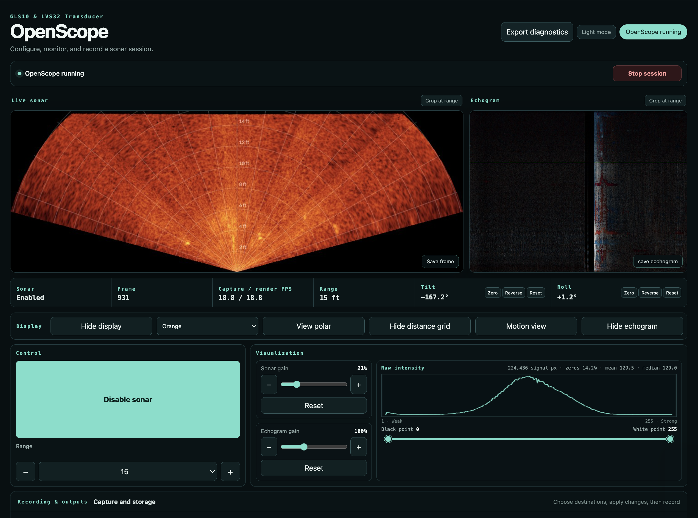

# OpenScope

OpenScope is an independent, open-source desktop sonar viewer for a GLS10 with
an LVS32 transducer. View live sonar and an echogram, adjust display settings,
and record video and frames with metadata.

[Download 0.1.0 beta](https://github.com/mahobley/OpenScope/releases/tag/v0.1.0) ·
[Quick start](docs/QUICK_START.md) · [Known issues](docs/KNOWN_ISSUES.md) ·
[Release notes](CHANGELOG.md)



*OpenScope displaying live sonar and an echogram at a selected range of 15 ft.
Recording options are farther down the interface, below the visible area.*

[Watch the demo video](https://youtu.be/OGPWhP_YDKI).

## Download and install

OpenScope 0.1.0 is a beta release. All four packages have been tested with sonar
hardware on their respective platforms.

| Platform | Download |
| --- | --- |
| macOS · Apple Silicon | [DMG](https://github.com/mahobley/OpenScope/releases/download/v0.1.0/OpenScope-0.1.0-arm64.dmg) |
| Windows · x64 | [Installer](https://github.com/mahobley/OpenScope/releases/download/v0.1.0/OpenScope.Setup.0.1.0.exe) |
| Linux · x64 · Debian/Ubuntu | [DEB](https://github.com/mahobley/OpenScope/releases/download/v0.1.0/OpenScope_0.1.0_amd64.deb) |
| Linux · x64 | [AppImage](https://github.com/mahobley/OpenScope/releases/download/v0.1.0/OpenScope-0.1.0.AppImage) |

Download the package for your platform, then follow the [quick start](docs/QUICK_START.md).
Windows requires a separate Npcap installation. Linux requires polkit and a desktop
authentication agent.

**Unsigned installers:** macOS and Windows may display a security warning.
The macOS build is not notarized.

**Administrator access:** OpenScope requests administrator rights to configure
the sonar network adapter and capture/send packets. On macOS and Linux, only
the backend is elevated; Windows runs the application with administrator rights.

**Known limitations:** disabling sonar sometimes does not work, and range control
sometimes requires a restart. Confirm the device response when using these
controls. See [known issues and troubleshooting](docs/KNOWN_ISSUES.md).

Testing covers Apple Silicon Macs, Windows x64, and Linux x64. Intel Macs, exact
minimum OS versions, and broader hardware/firmware compatibility remain unqualified.

## Documentation

- [Install and connect your sonar](docs/QUICK_START.md).
- [Run from a terminal](docs/RUN_FROM_SOURCE.md).
- [Build desktop apps](docs/BUILD.md).
- [Contribute](CONTRIBUTING.md) or [report a security issue](SECURITY.md).

## Layout

```text
desktop/    Electron desktop shell, assets, packaging, and tests
backend/    Python controller, sonar engine, browser viewer, and tests
docs/       User guides, build instructions, and protocol reference
scripts/    Native build and dependency-source helpers
build/      Generated Python backend and build intermediates (ignored)
dist/       Finished desktop installers for all platforms (ignored)
.github/    Automated checks and manual packaging workflow
```

The repository includes application source, tests, and build configuration.
Installers and matching third-party source archives are available on the
[GitHub release](https://github.com/mahobley/OpenScope/releases/tag/v0.1.0).

## License and project status

OpenScope code is licensed under the [MIT License](LICENSE). Bundled third-party
components retain their own licenses; see [third-party notices](THIRD_PARTY_NOTICES.md)
and the [licensing/source-distribution guide](docs/LICENSING.md).
This is a joint release by Mourad Derbedrosian and MAHobley; see [author credits](AUTHORS.md).
OpenScope is not affiliated with or endorsed by Garmin. GLS10 and LVS32 are
product names used to describe interoperability. This is beta software;
verify controls and recordings on your own setup.
